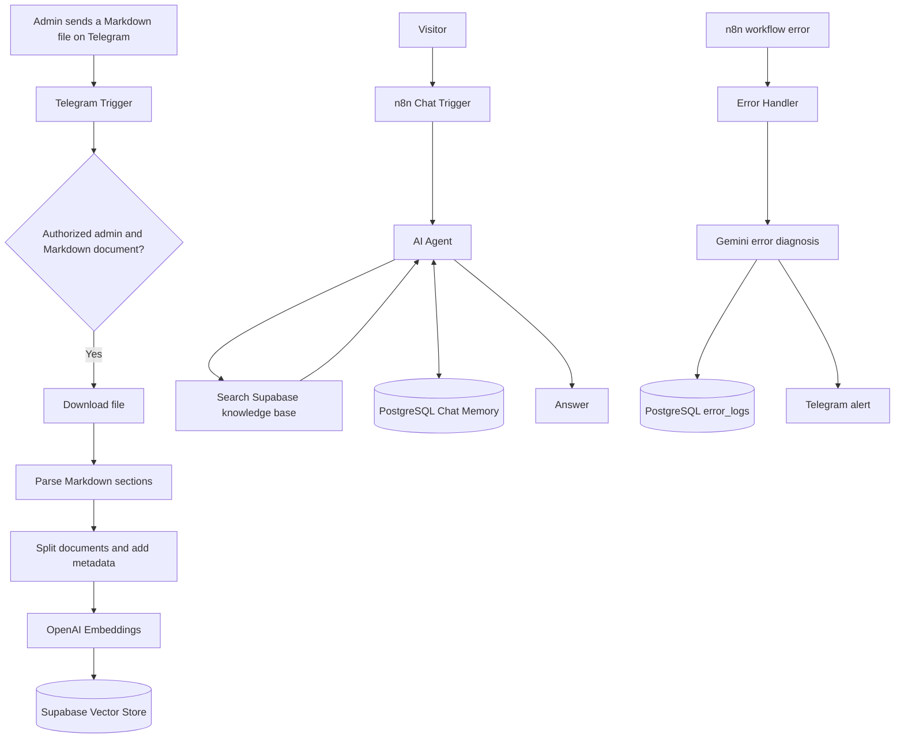

# ITC AI Assistant — RAG Chatbot

An AI-powered multilingual assistant for **IT Community (ITC)** at Saad Dahleb University of Blida (Blida 1), Algeria. It answers questions about the club's departments, workshops, events and rules using a Retrieval-Augmented Generation (RAG) knowledge base.

Built with **n8n**, **Supabase Vector Store (pgvector)**, **Google Gemini**, **OpenAI embeddings**, **PostgreSQL** and **Telegram**. The project is designed to run on a self-hosted n8n instance, including an n8n installation hosted on a VPS.

## What it does

- Answers questions about ITC departments, workshops, events, membership and club rules.
- Retrieves information from the ITC knowledge base stored in Supabase.
- Supports Arabic, Algerian Darija, French and English.
- Uses PostgreSQL Chat Memory to maintain conversation context.
- Ingests Markdown knowledge-base files sent by an authorized administrator through Telegram.
- Splits Markdown content into smaller documents, adds metadata and stores embeddings in Supabase.
- Uses Google Gemini as the chat model and for automated error diagnosis.
- Sends workflow error alerts through Telegram and logs failures in PostgreSQL.
- Applies grounding and prompt-injection guardrails defined in the AI Agent instructions.

## How it works



See [docs/architecture.md](docs/architecture.md) for the workflow architecture and data flow.

## Workflows

| # | Workflow file | Purpose |
|---|---|---|
| 01 | [01-itc-assistant.json](workflows/01-itc-assistant.json) | Main workflow: Telegram Markdown ingestion, document parsing, Supabase vector storage, chat trigger, AI Agent, retrieval and PostgreSQL conversation memory. |
| 02 | [02-error-handler.json](workflows/02-error-handler.json) | Captures workflow failures, prepares error details, requests a diagnosis from Gemini, logs the error in PostgreSQL and sends a Telegram alert. |

## Tech stack

| Component | Service | Purpose |
|---|---|---|
| Workflow automation | n8n | Runs the assistant and error-handling workflows |
| Chat model | Google Gemini | Generates assistant replies and diagnoses workflow errors |
| Embeddings | OpenAI | Converts knowledge-base content and user queries into vectors |
| Vector database | Supabase with pgvector | Stores and retrieves knowledge-base documents |
| Conversation memory | PostgreSQL | Stores chat history for the AI Agent |
| Error logging | PostgreSQL | Stores workflow error details in `error_logs` |
| Knowledge-base ingestion | Telegram Bot API | Receives Markdown files from the authorized administrator |
| Error notifications | Telegram Bot API | Sends error alerts to the configured administrator |

## Repository structure

```text
ITC-AI-Assistant/
├── README.md
├── .env.example
├── .gitignore
├── data/
│   ├── departments.md
│   ├── events.md
│   ├── faq_and_rules.md
│   └── workshops.md
├── workflows/
│   ├── 01-itc-assistant.json
│   └── 02-error-handler.json
└── docs/
    ├── architecture.md
    └── setup.md
```

## Knowledge base

The four Markdown files in [`data/`](data/) are the source documents used to populate the vector database:

- `departments.md` — ITC departments, responsibilities, activities and joining requirements.
- `events.md` — ITC events, competitions, schedules and related information.
- `faq_and_rules.md` — frequently asked questions, membership information and club rules.
- `workshops.md` — workshop descriptions, dates, venues, prerequisites and agendas.

The main workflow receives Markdown documents through Telegram. Send each `.md` file as a **document attachment**, not as copied message text. The workflow's current filter accepts messages from the administrator ID already stored in the workflow and checks for the `text/markdown` MIME type.

## Set it up

1. Deploy n8n on a VPS with a public domain and HTTPS.
2. Prepare Supabase with the `pgvector` extension and the `documents` table.
3. Prepare PostgreSQL for chat memory and the `error_logs` table.
4. Create the required n8n credentials for Google Gemini, OpenAI, Supabase, PostgreSQL and Telegram.
5. Import both JSON files from [`workflows/`](workflows/) into your n8n instance.
6. Re-select your own credentials in the imported nodes, then follow [docs/setup.md](docs/setup.md).
7. Activate the workflows, ingest the four Markdown files from `data/` through Telegram and test the chat interface.

The workflow exports are not a one-click installer. They contain the original workflow logic and credential references; you must connect credentials that exist in your own n8n instance and verify the configuration before production use.

## Important notes

- **VPS deployment:** This repository does not include a Docker Compose file or install script. It assumes that n8n is already installed and reachable through HTTPS on your VPS.
- **Credentials:** `.env.example` is a reference checklist. The workflows do not automatically read this file. Add credentials in the n8n Credentials manager.
- **Credential references:** Existing credential IDs and names inside the workflow exports are intentionally preserved. They identify credentials from the original n8n environment and do not contain the credentials' secret values. After importing, select or create the matching credentials in your own n8n instance.
- **Telegram administrator:** The current administrator Telegram ID and chat destination are embedded in the workflow conditions and notification node. They are retained from the source project. Update them in the relevant nodes if you deploy the project for a different administrator.
- **Secrets:** Never commit real API keys, bot tokens, database passwords or OAuth/client secrets.
- **Database compatibility:** The Supabase embedding column dimension must match the OpenAI embedding model configured in n8n.
- Test ingestion, retrieval, chat memory and error notifications before using the assistant in production.

## Author

Built by **Rabie Bouderga**. Portfolio: [rabie-bouderga.vercel.app](https://rabie-bouderga.vercel.app)
